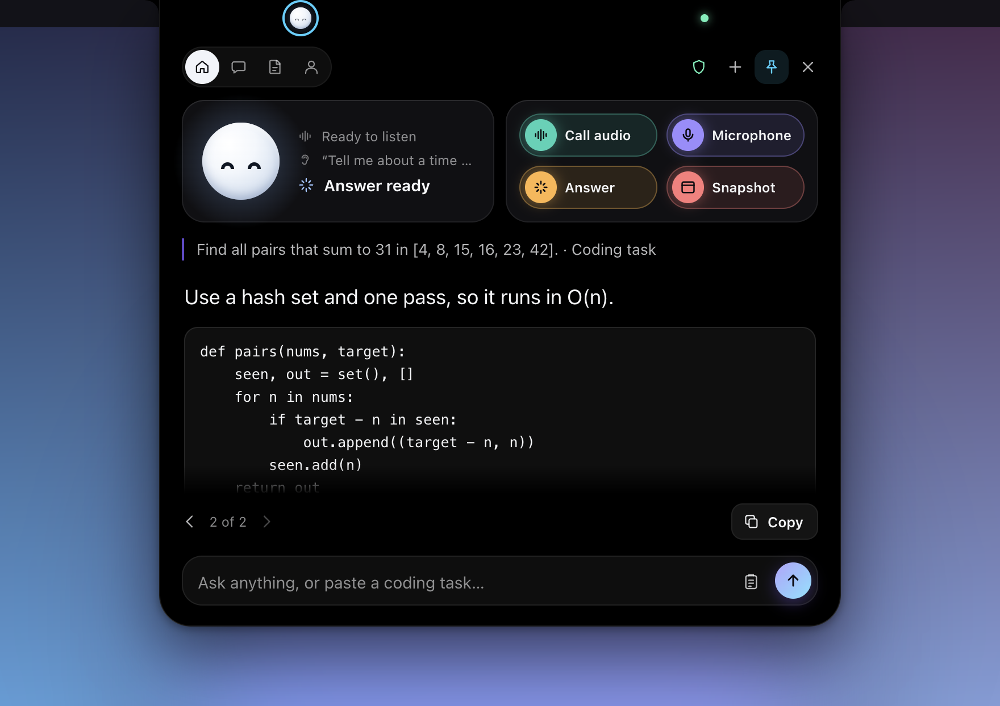

# Screening

Interview answers at your MacBook notch, right under your camera. Screening listens to the call, transcribes it on your Mac with Whisper, and drafts answers through your ChatGPT account. Everything happens in **Buddy**, a black island that grows out of the notch. When you read from Buddy, you are looking almost straight at the camera.

There are no other windows. A small island icon in the menu bar is the way in.



## Get started

1. Install Screening.
   - **Mac (Apple Silicon):** paste this in Terminal. It downloads the newest DMG, copies Screening to Applications and opens it.

     ```sh
     curl -fsSL https://raw.githubusercontent.com/dimqsh/Screening/main/install.sh | bash
     ```

     Or download the DMG from [Releases](https://github.com/dimqsh/Screening/releases), drag Screening to Applications, then right-click it and choose **Open** the first time.
   - **Windows (x64):** run the EXE from [Releases](https://github.com/dimqsh/Screening/releases). If SmartScreen warns, choose **More info**, then **Run anyway**.
2. Open Screening. The island icon appears in the menu bar, and Buddy opens at the notch with its setup steps.
3. **Download the speech model**, once. On Apple Silicon Macs Screening uses the Accurate model (Whisper large-v3-turbo, about 1 GB); on other computers it uses the Fast model (Whisper base, 77 MB). You can switch in the menu. After that, transcription works offline.
4. **Sign in with ChatGPT.** The bundled official Codex CLI opens your browser. Your ChatGPT plan, model access and limits apply. This does not turn a ChatGPT subscription into an OpenAI API key.
5. **Allow the microphone and call audio** on a Mac. One button asks for both, and each macOS prompt has an **Allow** button. Screening does not need screen recording on macOS 15 or later. If you turned one down before, System Settings opens on its page; call audio is under **System Audio Recording Only**. You can do this later from the menu, and updates keep both.
6. In Buddy, press **Call audio** to listen to the interviewer, or **Microphone** to listen to yourself. Press it again, now labeled **Stop**, to stop.
7. When the interviewer finishes a question, press Cmd/Ctrl+Shift+Enter. Buddy opens and streams the answer under your camera.

## Buddy

- **Buddy is a character**: a small round face with two eyes. It sleeps until setup is done, looks up and shows a "•••" badge while it thinks, reads along while an answer streams, smiles when the answer is ready, and looks worried if something fails. It blinks now and then, and its eyes follow your pointer.
- **Collapsed**, Buddy sits next to the notch with a green dot that means screen-sharing protection is on. While listening, it shows a waveform that follows the voice and a timer.
- **When an answer arrives**, Buddy opens a quiet reading view: the question and the answer in large type, nothing else. It closes a minute after the answer finishes.
- **Hover** to open the full island; click Buddy’s face to keep it open. The full island has icon tabs at the top, a card with Buddy and three steps (listen, hear, answer) with the current one lit, four chips (**Call audio**, **Microphone**, **Answer**, **Snapshot**), and four tabs:
  - **Answer**: the latest answer, earlier answers with the arrows, Copy, and a box to type or paste a question.
  - **Transcript**: what was heard, with times, and **Answer what was just said**.
  - **Notes**: talking points. Turn on **Use notes in answers** to send them with your questions.
  - **You**: your target role, skills and real wins. Buddy uses only what you write here and never makes up achievements.
- **Snapshot** a window to send a coding task or a diagram. Buddy takes one image, shows it in the box, and sends it with your next message. On macOS 15 and later, Snapshot opens the macOS window picker, so Screening needs no screen recording access; choose the window within about 10 seconds. On macOS 14 and Windows, Buddy shows its own window list.
- Buddy never takes the keyboard on its own, so Zoom, Meet or Teams keeps it. Buddy takes the keyboard only while you type in one of its fields, and gives it back when you send, press Escape or click elsewhere. Outside the island, clicks pass through to the apps below.
- **Drag Buddy by its top bar** to take it off the notch. It becomes a small window you can leave anywhere, and Screening remembers where. **Snap Buddy to the Notch** in the menu puts it back.
- Floating Buddy, and Buddy on screens narrower than 1400 points, use a compact layout: a narrower island with the face and steps above the chips.
- On Windows, and on Macs without a notch, Buddy hangs from the top edge as a small pill.

## The menu-bar menu

Click the island icon in the menu bar for everything else: start or stop listening, answer, ask, show or hide Buddy, **Float Buddy** or **Snap Buddy to the Notch**, **Allow Microphone and Call Audio…** while either is off, interview type, answer length, automatic answers, notes in answers, speech and answer language, **Hide From Screen Sharing**, **Test Screen Sharing Protection**, setup status, **Export Session**, **New Session** and **Quit**. While Screening listens, the icon fills in and the menu bar shows the elapsed time.

| Action                       | Shortcut             |
| ---------------------------- | -------------------- |
| Answer what was just said    | Cmd/Ctrl+Shift+Enter |
| Ask Buddy                    | Cmd/Ctrl+Shift+Space |
| Start or stop listening      | Cmd/Ctrl+Shift+L     |
| Show or hide Buddy           | Cmd/Ctrl+Shift+B     |

Shortcuts work in every app. Cmd+Shift+B replaces Chrome’s bookmarks-bar shortcut while Screening runs.

## Languages

The interface is in English. Speech and answers default to English. You can pick automatic detection or Spanish, Chinese, French, German, Japanese, Russian, Ukrainian, Kazakh or Turkish in the menu. Automatic detection uses Whisper’s language-token logits.

**Speech Model** in the menu chooses between two multilingual Whisper models. We tested both on one interview question per language, spoken by the macOS voices for English, Russian, Spanish, German, Ukrainian, Kazakh, Chinese, Japanese and Turkish, plus a real English recording, on an M3 Pro:

| Model | Download | Time per 8-second chunk | Words wrong, average | Ukrainian | Kazakh |
| --- | --- | --- | --- | --- | --- |
| Accurate: large-v3-turbo, 8-bit encoder | about 1 GB | about 3.5 s | 5% | 9% | 25% |
| Fast: base, 8-bit | 77 MB | about 0.7 s | 17% | 36% | not recognized |

Synthetic voices are cleaner than a real call, so expect more errors in noise and with strong accents. The Accurate model needs a fast CPU to keep up with live speech, which is why it is the default only on Apple Silicon.

Audio is processed in about eight-second chunks. The waveform moves before the first line arrives. Stop sends the remaining audio through Whisper. A bundled Silero detector skips chunks without speech before Whisper runs; it does not tell speakers apart. Call audio can include sound from other apps. On macOS 14.2 and later it comes from a Core Audio tap, which needs only System Audio Recording; before that it goes through ScreenCaptureKit, which needs screen recording. The local queue is bounded: if the computer cannot keep up, Screening reports an error instead of buffering without limit.

## Account and data

ChatGPT sign-in uses the official, bundled `@openai/codex` CLI. Screening never reads or copies OAuth tokens. Authentication is shared with the local Codex CLI, so signing in here may change the account other Codex clients use. The CLI owns its login storage and browser flow.

Whisper receives audio on your computer. ChatGPT receives the typed question or the latest four transcript chunks, your background from the **You** tab, a bounded recent conversation, and notes only when **Use notes in answers** is on. A window snapshot is sent once, with the next message. The temporary image file is removed after the request or when Screening quits. Window thumbnails in the picker stay on your computer. Nothing watches the active window or captures it on a timer. Requests use ephemeral, read-only Codex execution, ignore user config, plugins and MCP, and disable shell and web tools. Answers need internet and count against your Codex allowance. Screening is an independent project, not an OpenAI product.

Whisper runs in its own process at a lower CPU priority, so the meeting app and Buddy stay smooth while it works. It loads into memory when you start listening, and unloads 90 seconds after you stop or after the last transcription. A loaded model uses about 0.7 GB (Fast) or 2.4 GB (Accurate); an idle Screening uses about 120 MB in total.

Audio, transcripts, answers, notes and snapshots stay in memory and are not saved automatically. Buddy keeps up to 60 messages and six snapshots; ChatGPT gets the latest 12 messages within a 24,000-character budget. Follow-ups use the text history; older snapshots are not sent again. **Export Session** saves the transcript, the conversation and your notes as text. **New Session** clears them. Preferences persist on your computer. Your background is encrypted with the OS key store when one is available; otherwise it stays in memory. The speech model and the Codex sign-in are stored separately and never ship with the source or the installers.

## Screen sharing protection

Buddy asks the operating system to leave it out of screen capture before it first appears. **Test Screen Sharing Protection** in the menu shows a synthetic card in Buddy and compares a magenta marker with protection off and on, on each capture path the system offers. A missing unprotected marker counts as inconclusive. Always check what the other person sees in your meeting app.

On macOS 14+, Buddy presents its pixels through a native `AVSampleBufferDisplayLayer` with `preventsCapture` enabled. A dedicated layer-hosting NSView owns this layer directly: the layer is assigned before enabling `wantsLayer`, without an intermediate AppKit backing layer. Its original Chromium view remains in place for input, with its ordinary drawing suppressed. The protected companion follows Buddy's position and visibility and passes mouse events through. Frames stay in memory; this does not record the desktop. A presentation failure hides Buddy instead of falling back to unprotected drawing.

The macOS test includes an independent `CGDisplayStream` recorder in addition to Electron and ScreenCaptureKit. Before the test turns protection off, it waits for the synthetic card and discards the previous presentation layer and its queued images.

Capture tests cannot prove visibility on the physical display. Check Buddy locally as well: open it, use **Keep open**, select **Notes**, and type. The automated native input test exercises mouse hit testing, text insertion, selection, hide/show and resizing; physical visibility is a separate manual check.

On the tested macOS 27.0.1 system, the earlier AppKit-backed companion disappeared locally during Telegram calls. After switching to the dedicated layer-hosting view, the user confirmed that the labeled source preview stayed visible and accepted text in an open Telegram call. This is local physical verification, not a guarantee for every OS or meeting app. Native visible/ready flags and the fullscreen Space lifecycle test alone cannot establish physical visibility.

Historical results: version 0.1.0 was tested with Google Meet sharing the whole built-in screen on macOS 27.0.1 and Chrome 155. Two connections joined from the same Mac showed the overlay with protection off and left it out with protection on. That was not a second physical device. Version 0.6.0 ran the A/B check on macOS 27: with protection on, both the Electron and the ScreenCaptureKit paths dropped Buddy’s marker. No private meeting screenshots are included in this repository.

The test captures the screen itself, so it is the one feature that asks for screen recording on macOS 15.

Capture exclusion is not a universal bypass. Electron documents that newer macOS ScreenCaptureKit recorders may ignore the flag, and Windows limits the guarantee to supported capture APIs. Screening does not bypass microphone or screen permissions, app security controls or process inspection.

## Development

Node.js 22+ and npm; macOS 14+ for the Mac app. Xcode command-line tools compile the macOS helpers and the N-API protected presentation module.

```sh
npm ci
npm run build:native # macOS; skipped on Windows
npm start
npm test
npm run verify
npm run verify:capture # needs screen permission; shows a synthetic marker
npm run verify:protected # macOS native input/lifecycle and continuous CGDisplayStream checks
npm run package:mac # Apple Silicon DMG, on macOS
npm run package:win # x64 NSIS EXE, on Windows
```

The app is three pieces. `src/buddy.*` is the only visible window. `src/engine.html` is a hidden window that owns microphone and Windows call-audio capture. `src/main.cjs` runs the menu-bar icon, shortcuts, notch placement and screen-sharing protection; `src/tray-menu.cjs` builds the menu.

`npm run verify` checks that Buddy is the only visible window, the engine stays hidden, there is no Dock icon, the menu-bar icon exists, and protection, focus hand-off, notch placement, floating and snapping back, the access step, notes, background, paste and English text all work. It saves screenshots of Buddy’s states in `validation/` using synthetic data; no account request is made.

To test real speech, run `node scripts/prepare-speech-test.cjs`, set `CAPTURE_LAB_TEST_AUDIO` to the absolute `build/jfk.f32` path, and run `npm run verify:audio`. `--interview-test` transcribes the public JFK sample with real Whisper. `--audio-test` presses Buddy’s Microphone chip and feeds the sample through a synthetic MediaStream and a real AudioWorklet in the hidden engine, hides and shows Buddy while it listens, and checks the final transcript; it does not test a physical microphone. `--system-audio-test` on macOS expects speech played on the computer after the `native-audio-ready` marker. `--live-ai-test` and `--vision-test` make real ChatGPT requests: the vision test snapshots a synthetic coding task through the OS picker, asks for a solution and a follow-up, and checks Copy.

The Windows release workflow builds and installs the EXE, then runs `--verify --interview-test` on it. The Mac DMG must be signed with Screening’s certificate, so it is built with `npm run package:mac` on a Mac that has the certificate until the macOS workflow passes the signing secrets. It does not check a meeting recipient’s view or the sign-in flow on a Windows account.

The Mac app is signed with Screening’s own certificate, not an Apple Developer ID, and it is not notarized. macOS remembers the microphone and call audio permissions by that certificate, so updates keep them. Versions before 0.7.1 were ad-hoc signed, so macOS treated every update as a new app. Gatekeeper may still ask you to confirm a DMG downloaded in a browser, and SmartScreen may ask on Windows; `install.sh` removes the download quarantine so the app opens directly. There is no auto-update; run the install line again to update.

`npm run package:mac` signs with `~/.screening-signing/screening-signing.p12` and the password in `password.txt` next to it, or with the `SCREENING_SIGN_P12` (a file path or base64) and `SCREENING_SIGN_PASSWORD` environment variables. Without a certificate, a local build is ad-hoc signed, and a GitHub Actions build fails rather than ship a release that loses everyone’s access. Keep the certificate backed up: a release signed with a different one makes every user allow access again.

## Sources and licenses

- [OpenAI Codex authentication](https://learn.chatgpt.com/docs/auth) and [Codex SDK](https://learn.chatgpt.com/docs/codex-sdk).
- [Transformers.js audio processing](https://huggingface.co/docs/transformers.js/guides/node-audio-processing), [Whisper large-v3-turbo](https://huggingface.co/onnx-community/whisper-large-v3-turbo) and [Whisper base](https://huggingface.co/onnx-community/whisper-base) ONNX models, [OpenAI Whisper](https://github.com/openai/whisper), [Silero VAD](https://github.com/snakers4/silero-vad).
- [Electron window sources](https://www.electronjs.org/docs/latest/api/desktop-capturer), [content protection](https://www.electronjs.org/docs/latest/api/browser-window#winsetcontentprotectionenable), [audio loopback](https://www.electronjs.org/docs/latest/api/session#sessetdisplaymediarequesthandlerhandler-opts) and [Tray](https://www.electronjs.org/docs/latest/api/tray).
- Copy reviewed with [Peter Yang’s no-ai-slop skill](https://github.com/petergyang/no-ai-slop); layout follows the locally installed ui-ux-pro-max guidance.

Original application code: MIT. Electron: MIT. OpenAI Codex: Apache-2.0. Transformers.js: Apache-2.0. Silero VAD: MIT. ONNX Runtime: MIT. Whisper weights: Apache-2.0 per the model repository. Dependency license files are kept in the packaged dependencies.
