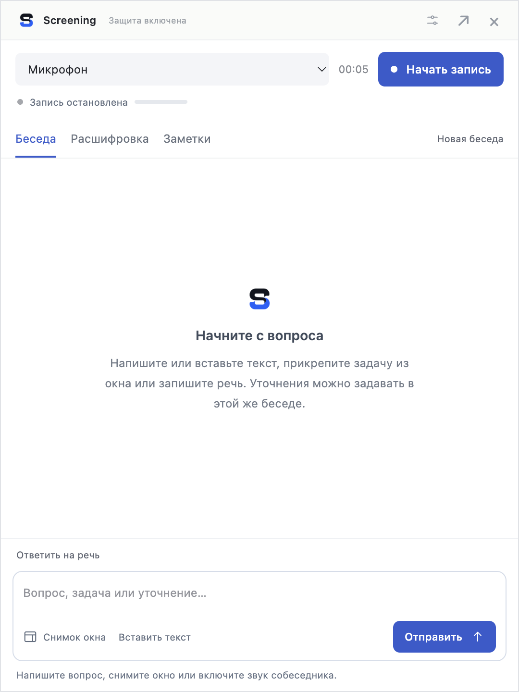

# Screening

Desktop interview chat for macOS and Windows. Local multilingual Whisper, answers through your ChatGPT account, window snapshots, optional notes, and a compact floating view. Formerly Capture Lab; the application ID and local data folder stay the same for upgrades.



## Use

1. Install the DMG (Apple Silicon) or EXE (Windows x64) from this repository’s Releases.
2. Open **Settings → Sign in with ChatGPT**. The bundled official Codex CLI opens a browser. An existing Codex ChatGPT sign-in is reused. Plan eligibility, model availability and account limits apply; this does not turn a ChatGPT subscription into an OpenAI API key.
3. Select **Set up Whisper**. The first run downloads the multilingual `onnx-community/whisper-base` q8 model (about 75 MB of weights plus small tokenizer files). Later transcription runs locally without an internet connection. The model loads again when the app starts.
4. Choose **System audio** for the interviewer’s voice, or **Microphone** for your own voice. Grant the requested operating-system audio/screen permissions, then start recording.
5. Pick an interview type: general, coding, system design, behavioral, case/product, or HR. Type/paste a question and press Cmd/Ctrl+Enter. Ask follow-ups in the same chat. For the recent transcript, use **Send** with an empty composer or Cmd/Ctrl+Shift+Enter. Automatic voice answers are optional. Add real experience in **My context**.
6. Select **Window snapshot**, choose one window, preview the attachment, then send your message. Each click takes one image; there is no background window tracking. Remove the attachment to discard it. A pending attachment pauses automatic voice answers so it can be reviewed before sending.
7. In **Notes**, switch notes on/off. **Use in answers** separately controls whether their text goes to ChatGPT. Turning notes off preserves the text for the current session. Copy a message or an individual code block with its copy button. Paste text with the composer button or the usual keyboard shortcut.
8. The app starts in its compact workspace. It includes recording controls, a live input meter, transcript, chat, notes, text paste, window snapshots and setup. Use the expand button for the larger workspace and candidate context. Closing the large window returns to compact view and keeps the audio/session alive. Use the application menu to quit.
9. Both windows request native capture exclusion by default. **Hide both windows** or Cmd/Ctrl+Shift+H removes them from your desktop while audio continues; restore through the Dock/app icon, the menu or the show/recover shortcuts.

Interface languages: Russian, English and Kazakh. Speech and answer selectors include automatic language selection and Russian, English, Kazakh, Spanish, French, German, Chinese, Japanese, Ukrainian and Turkish. Automatic speech language detection uses Whisper’s language-token logits. Language availability does not imply equal recognition accuracy; small models can mishear words, especially in noise and weaker-supported languages.

Audio is processed in roughly eight-second chunks; the input meter moves before the first transcript arrives. Stop flushes the remaining audio through Whisper. Microphone and Windows loopback streams have one renderer owner; controls in either window address that owner and keep it running while its window is hidden. macOS system capture waits for a native ready acknowledgement before showing a recording state. The local queue is bounded; if the device cannot keep up, the app reports an error instead of growing an unlimited buffer. A bundled Silero detector filters chunks without detected speech before Whisper runs. It does not identify speakers. System audio can include sounds from other applications.

## Account and data

ChatGPT sign-in uses the official, bundled `@openai/codex` CLI. Screening never reads or copies OAuth tokens into its UI. Authentication is shared with the local Codex CLI. Sign-in from this app may change the account used by other Codex clients. The CLI owns its login storage and browser flow.

Whisper receives PCM audio locally. The assistant receives the typed question or the latest four transcript chunks, candidate context, a bounded recent chat history, and notes only when both notes switches are enabled. A selected window image is attached once, with the next manually sent answer request. A temporary PNG is removed after the request or app shutdown. Choosing a window lists local preview thumbnails; previews are not sent to ChatGPT. Capture requires OS screen-recording permission. Nothing monitors the active window or captures it on a timer. Requests use ephemeral, read-only Codex execution, ignore user config/plugins/MCP, and disable shell and web tools. No repository is attached. Assistant requests require internet and consume the signed-in account’s Codex allowance. This is an independent prototype, not an OpenAI product.

Raw audio, transcripts, chat messages, notes and window images are held in memory, not automatically saved. Chat keeps up to 60 messages and six image previews; model context uses the latest 12 messages within a 24,000-character budget. Follow-ups use text history; older images are not reattached. You can export the transcript, conversation and enabled notes as text. A new conversation clears transcript, messages and pending image. Preferences persist locally. Candidate context is encrypted with Electron safeStorage when the OS key store is available; otherwise it remains in memory. Model files and official CLI authentication persist separately. Credentials and models are never distributed with the source or installers.

## Screen capture

Both the compact and large windows request native content protection before they are first shown. The shared protection switch applies to both. Choose the compact or large window for the capture experiment. It displays a synthetic card and compares its magenta marker with protection off and on; a missing unprotected marker is inconclusive. Always check the actual recipient view for your meeting app and recorder.

Historical verification: version 0.1.0 was tested with Google Meet entire built-in-screen sharing on macOS 27.0.1 / Chrome 155. Two independently joined connections on the same Mac showed the overlay with protection off and omitted it with protection on. This was not a second physical device. Local regression checks cover Electron desktop capture and Apple ScreenCaptureKit; the historical Meet check does not establish every version or capture path. Version 0.4.0 adds separate local A/B checks for both windows. No private meeting screenshots are included in this repository.

Native capture exclusion is not a universal bypass. Electron documents that newer macOS ScreenCaptureKit recorders may ignore the flag; Windows also limits the guarantee to supported capture APIs. The app does not bypass OS microphone/screen permissions, application security controls or process inspection. Use the actual recipient view to determine whether a particular capture path respects protection.

Hotkeys:

| Action                   | Shortcut             |
| ------------------------ | -------------------- |
| Show/hide compact window | Cmd/Ctrl+Shift+Space |
| Hide both windows        | Cmd/Ctrl+Shift+H     |
| Recover mouse control    | Cmd/Ctrl+Shift+R     |
| Show workspace           | Cmd/Ctrl+Shift+L     |
| Answer recent transcript | Cmd/Ctrl+Shift+Enter |

## Development

Node.js 22+, npm. Xcode command-line tools are required to compile the macOS audio/capture helpers.

```sh
npm ci
npm run build:native # macOS; harmless skip on Windows
npm start
npm test
npm run verify
npm run verify:capture # requires screen permission; shows a synthetic marker
npm run package:mac # Apple Silicon DMG, on macOS
npm run package:win # x64 NSIS EXE, on Windows
```

`npm run verify` exercises native protection flags, recovery, IPC validation, editable notes, renderer isolation and interface language switching. To exercise real speech recognition, run `node scripts/prepare-speech-test.cjs`, set `CAPTURE_LAB_TEST_AUDIO` to the absolute `build/jfk.f32` path, and run `npm run verify:interview`. `--live-ai-test` additionally makes a real account-backed request; it requires ChatGPT sign-in. `--compact-test` exercises compact controls, Unicode paste, hidden-workspace recording, closing the workspace, emergency hide/recovery, input level and final-buffer transcription through a synthetic MediaStream, real AudioWorklet and real Whisper. This is not a physical-microphone test. `--system-audio-test` on macOS expects external speech playback after the native-audio-ready marker; it checks real system audio from compact controls. `--screening-test` checks notes, paste and minimum window layout; combine it with `--vision-test` to capture a synthetic task window through the OS, send its image to ChatGPT, ask a follow-up and verify code copying. This consumes two account-backed requests and needs screen access.

The Windows release workflow builds a native Windows installer, installs the EXE and launches the installed application and checks actual Whisper transcription of the public JFK sample. It does not establish a Windows meeting-recipient capture result or test the interactive OAuth flow on a Windows user’s account.

Installers are currently unsigned by a publisher certificate; the Mac bundle is ad-hoc signed. macOS Gatekeeper and Windows SmartScreen may require an explicit open/install decision. No auto-update service is enabled.

## Sources and licenses

- [OpenAI Codex authentication](https://learn.chatgpt.com/docs/auth) and [Codex SDK](https://learn.chatgpt.com/docs/codex-sdk).
- [Transformers.js audio processing](https://huggingface.co/docs/transformers.js/guides/node-audio-processing), [Whisper base model](https://huggingface.co/onnx-community/whisper-base), [OpenAI Whisper](https://github.com/openai/whisper), [Silero VAD](https://github.com/snakers4/silero-vad).
- [Electron window sources](https://www.electronjs.org/docs/latest/api/desktop-capturer), [content protection](https://www.electronjs.org/docs/latest/api/browser-window#winsetcontentprotectionenable) and [audio loopback](https://www.electronjs.org/docs/latest/api/session#sessetdisplaymediarequesthandlerhandler-opts).
- UI copy reviewed with [Peter Yang’s no-ai-slop skill](https://github.com/petergyang/no-ai-slop); workspace layout follows the locally installed ui-ux-pro-max guidance.

Original application code: MIT. Electron: MIT. OpenAI Codex: Apache-2.0. Transformers.js: Apache-2.0. Silero VAD: MIT. ONNX Runtime: MIT. Whisper weights: Apache-2.0 per the model repository. Dependency license files are retained in the packaged dependencies. No Cluely source, assets or proprietary binaries are included.
